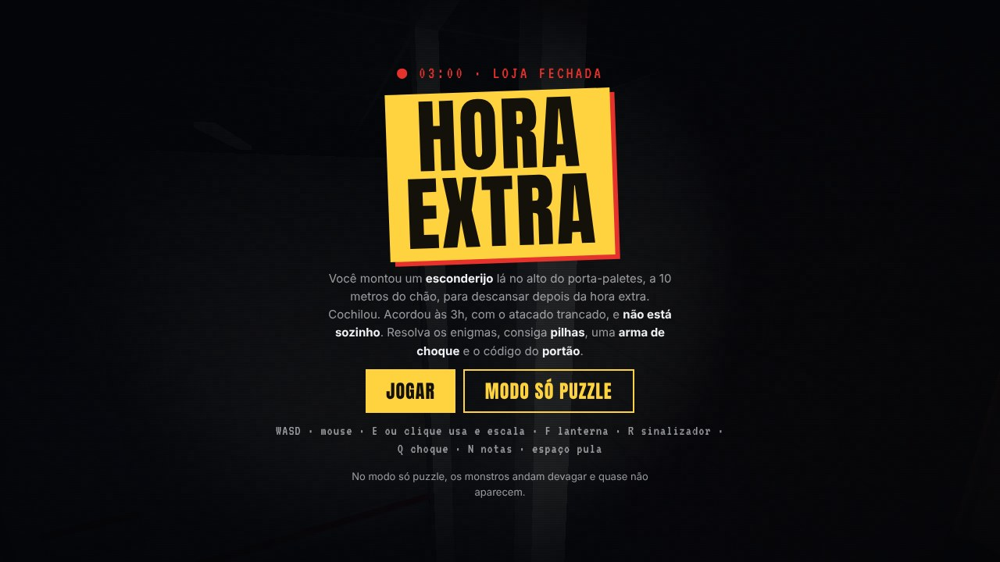
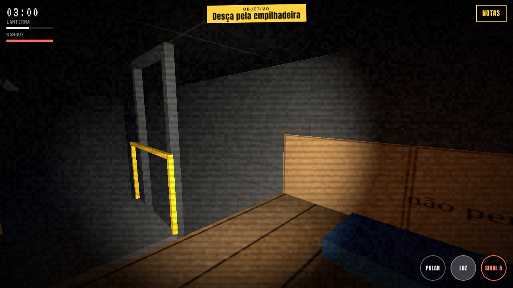
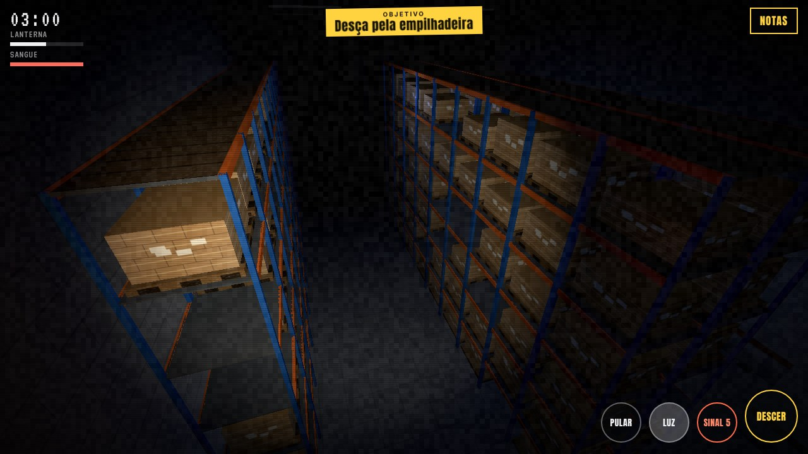
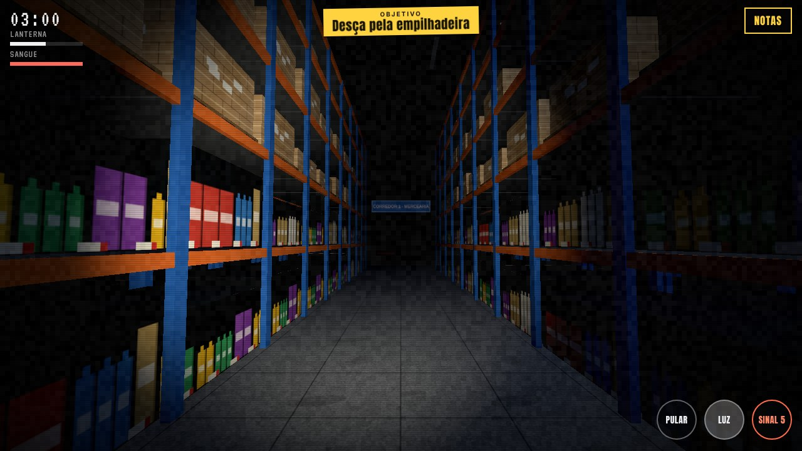
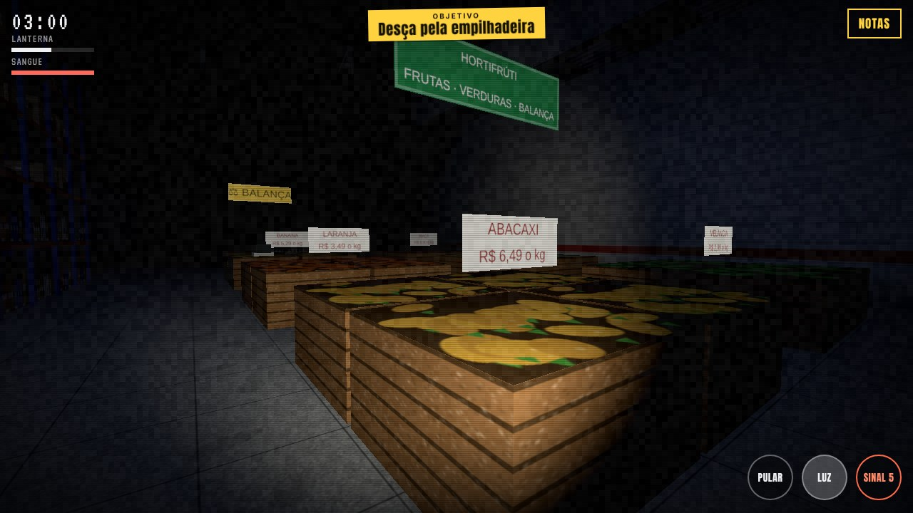
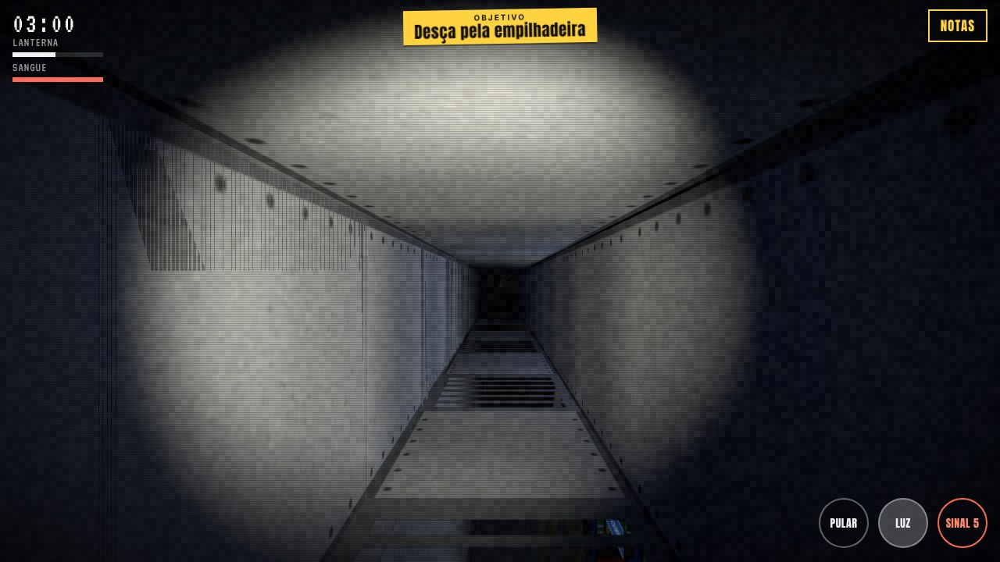
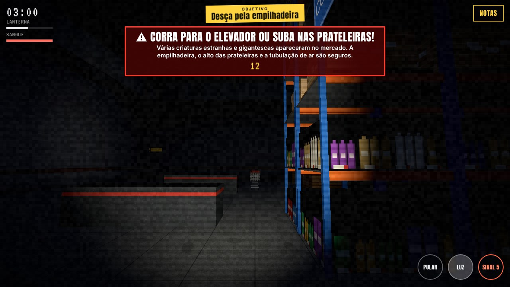
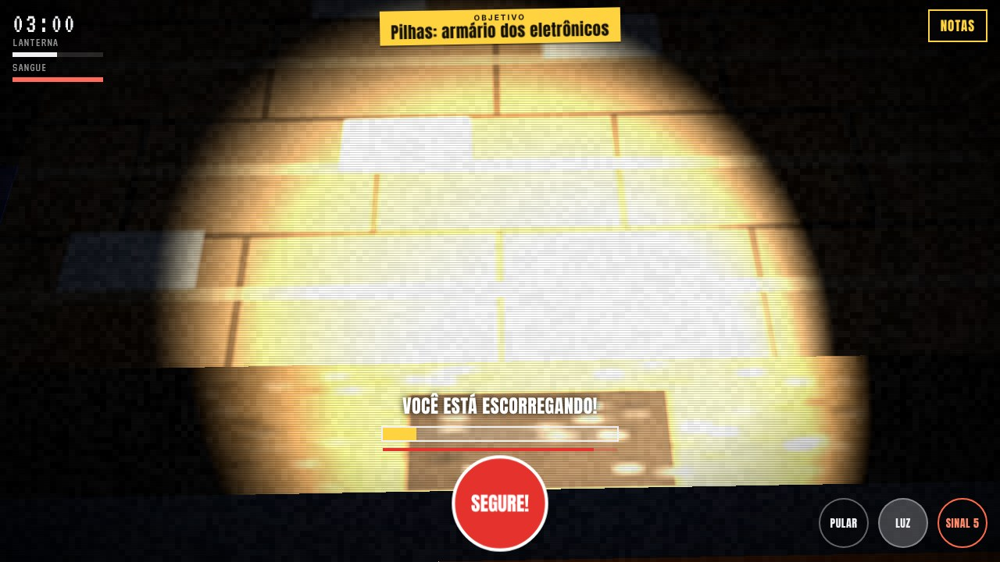

  

<h1 align="center">HORA EXTRA</h1>

  <b>Jogo de terror e puzzles em primeira pessoa para Android.</b> 
  Você cochilou no seu esconderijo, no alto do porta-paletes de um atacado. Acordou às 3h da manhã, com tudo trancado, e o mercado não está vazio.

  

---

## O jogo

Depois de uma hora extra, você montou um esconderijo a 10 metros do chão, em cima dos porta-paletes do depósito, para descansar. Perdeu a hora. Agora o atacado está fechado, escuro, e criaturas bizarras andam pelos corredores.

Para sair, é preciso descer com a empilhadeira, resolver os enigmas da loja, conseguir **pilhas** para a lanterna, abrir o cofre onde está a **arma de choque**, religar a **energia** e descobrir o código do **portão**.

## Telas

| O esconderijo | Vista do alto |
|:---:|:---:|
|  |  |

| Os corredores | O hortifrúti |
|:---:|:---:|
|  |  |

| Pela tubulação de ar | O alarme |
|:---:|:---:|
|  |  |

   
  Escorregou na prateleira? Aperte SEGURE! até encher a barra, ou caia.

## Mecânicas

- **Enigmas pela loja:** balança do hortifrúti, quadro de energia, cofre da segurança e o portão de saída, cada um com sua lógica.
- **Placas de mercado de verdade:** seções, preços e corredores para se orientar no escuro.
- **Escalar prateleiras:** numa fuga desesperada dá para subir nas prateleiras. Se escorregar, aparece a barra de força; se cair, perde muito sangue.
- **Tubulação de ar:** fica no alto, com escadas para subir. Serve de esconderijo, mas um parafuso pode soltar, o painel cede e você cai atordoado, com a visão turva.
- **O alarme:** a qualquer momento uma sirene estranha avisa que criaturas gigantescas invadiram o mercado. Corra para o elevador ou suba nas prateleiras.
- **Colosso e mulheres-aranha:** um gigante deformado que anda entre os corredores e criaturas de cabelos longos presas no teto, entre teias. Não atacam, mas ninguém se acostuma.
- **Sinalizador com 5 tiros, lanterna com bateria e arma de choque** para se defender do monstro que caça você.
- **Modo só puzzle:** os monstros andam devagar e quase não aparecem.

## Tecnologias

Three.js (3D) · JavaScript · Capacitor (Android) · Web Audio · GitHub Actions

---

© 2026 Davi Barros de Lima. Todos os direitos reservados. O código-fonte deste projeto é privado, e este repositório reúne só a apresentação do jogo. Consulte o arquivo <a href="LICENSE">LICENSE</a>.
